### `edson@github ~ $ ./contributions.sh`

  

### `edson@github ~ $ whoami`

<table>
  <tr>
    <td valign="top"></td>
    <td valign="top"></td>
  </tr>
</table>

**[Portfolio](https://www.edsonedwinninan.online) · [LinkedIn](https://linkedin.com/in/edson-edwin-ninan) · [Email](mailto:edsonedwin01@gmail.com) · [LeetCode](https://leetcode.com/u/Edson-Edwin/)**

### `edson@github ~ $ cat about.md`

I'm **Edson Edwin Ninan**, a Software Developer focused on **backend and cloud-native systems**. I build REST APIs and microservices with **Java, Spring Boot, and Python**, and deploy projects on **AWS** with **Docker, Terraform, and CI/CD**.

Currently pursuing my **MCA at Amal Jyothi College of Engineering (CGPA: 8.86)**. My cloud and DevOps internship at **IPSR Solutions** covered AWS, Azure, Terraform, and Ansible.

### `edson@github ~ $ ls stack/`

| Area | Technologies |
|:---|:---|
| Languages | Java, Python, JavaScript, Bash, HTML, CSS |
| Backend | Spring Boot, Django, Django REST Framework, FastAPI |
| Databases | PostgreSQL, MySQL, MongoDB |
| Cloud & DevOps | AWS, Azure, Docker, Terraform, Ansible, Linux, GitHub Actions, Nginx |
| Tools | Git, GitHub, VS Code, Postman |

### `edson@github ~ $ ls projects/`

| Project | Description | Stack |
|---|---|---|
| **LuxeStay** | Full-stack hotel management platform | Django REST Framework, Next.js, MySQL, AWS EC2, S3 |
| **Rider Sync** | AI-powered ride-sharing platform (ongoing) | Spring Boot, FastAPI, PostgreSQL, Docker, Terraform, Gemini API |
| **SkillSwap** | Peer-to-peer learning platform with real-time messaging | Java (Android), Django REST Framework, WebSockets, JWT |
| **Docker Monitoring Stack** | Container and service monitoring setup | Docker, Prometheus-style monitoring |
| **DevOps Automation Scripts** | Infrastructure automation utilities | Bash, Python |

### `edson@github ~ $ cat now.txt`

- System design fundamentals
- Backend API architecture and scalability
- Cloud infrastructure and Infrastructure-as-Code
- Data structures & algorithms practice

### `edson@github ~ $ ./connect.sh`

I'm open to Software Developer and Backend Engineer roles. Feel free to reach out via [LinkedIn](https://linkedin.com/in/edson-edwin-ninan) or [email](mailto:edsonedwin01@gmail.com).

Portrait and cards are generated locally as animated SVGs. The contribution calendar refreshes daily through GitHub Actions. [Generation scripts](./scripts/README.md).
